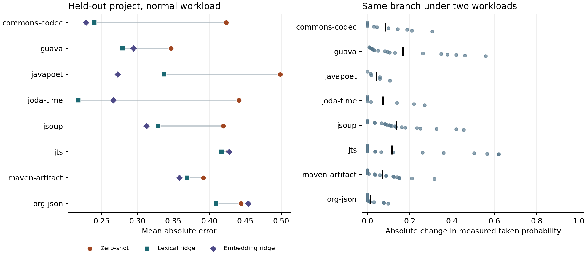

# Can a small code model predict JVM branch probabilities?

## Abstract

We ask whether a frozen 0.49B-parameter code model, Qwen2.5-Coder-0.5B-Instruct, can estimate how often a Java bytecode conditional jump is taken from static information alone. Labels come from instrumented execution of 193 original conditional sites in eight upstream Maven libraries, 138 of which ran under each of two constructed workloads. Models, folds and primary contrasts were registered before collection, and each library is held out in turn. Prompted for a 0–9 rating, the model returned a near-constant value between 0.34 and 0.49 whose rank correlation with the measured probability was −0.04. Its macro mean absolute error (MAE) on held-out libraries was 0.424, against 0.429 for a constant 0.5 and 0.325 for a lexical ridge regressor; the paired difference from the lexical model was +0.099 (95% project-bootstrap interval 0.050 to 0.152). A ridge readout of the model's final hidden state reached 0.327, a difference of +0.002 (−0.022 to 0.024) from the lexical model. Its predictions differed from those of the structural ridge that shares its other features by a median of 0.003. Masking identifiers changed the macro MAE of either readout by at most 0.003. Between the two traces, the measured probability changed by more than 0.10 at 42 sites. With equal weight per workload and per project, the observed differences imply a macro MAE floor of 0.044 for a predictor that assigns each site one fixed value. On this corpus the evidence does not support using the model's prompted rating or its pooled final state as a branch-probability estimator. An exploratory rerun with the 1.5B checkpoint of the same model family gave the same pattern.

## Introduction

A conditional jump has a fixed location in a Java class file. Its probability of taking the jump depends on the inputs that reach it. For example, the same instruction in a geometry library can check whether two envelopes are disjoint under a workload dominated by intersections or one dominated by separated objects. A static estimator must return the same value in both cases. We study the error incurred by that decision and ask whether a small language model (SLM) can exploit method names and local bytecode to improve it. [Geometry driver and other workloads](../java/corpus/Workloads.java)

Our estimand is the fraction of executions of a particular original bytecode instruction that jump to its target under a specified workload. Execution supplies the test labels. At prediction time, all models receive only static information. We address four questions. **RQ1** compares a frozen code SLM, used directly or as a feature extractor, with structural predictors. **RQ2** asks what changes when identifiers are masked and whether the learned representation adds value beyond lexical features. **RQ3** measures transfer to a library absent from model fitting. **RQ4** measures how much the target changes when the input mixture changes on identical code. We registered the models, folds, primary comparisons and evaluation metrics before collecting the library outcomes. [Study protocol](../experiments/study/protocol.md) · [Registration commit](https://github.com/minggu151623/llm_profiling_research/commit/e6e775c)

## Related work

Ball and Larus combined natural-loop analysis with heuristics for non-loop branches to predict direction. Wu and Larus used heuristic success rates to estimate conditional probabilities and propagated those probabilities to obtain relative execution frequencies. At binary level, VESPA adapted regression features to native code and supplied inferred profiles to BOLT. At compiler IR level, GraalSP used structural features and a boosted regressor, while GraalNN encoded basic-block graphs and caller context. A direct comparison against either Graal system would require mapping the relevant IR edge and its orientation back to the original bytecode jump. The GraalSP author's dissertation reports a held-out root mean squared error (RMSE) of 0.299 for its XGBoost regressor, trained on 323,350 branches from 44 libraries and tested on separate benchmark programs. That figure concerns Graal IR splits in other programs and workloads, so it is not a reference error for our sites. [Ball–Larus](https://doi.org/10.1145/155090.155119) · [Wu–Larus](https://doi.org/10.1145/192724.192725) · [VESPA](https://doi.org/10.1145/3485521) · [GraalSP](https://doi.org/10.1016/j.jss.2024.112058) · [GraalNN](https://doi.org/10.1145/3696443.3708958) · [GraalSP dissertation, Table 6.2](https://uvidok.rcub.bg.ac.rs/handle/123456789/6474)

Raman and Li provide a direct precedent for lexical branch prediction. Their LLVM predictor includes learned embeddings of called-function names in blocks controlled by the branch and trains against branch weights from SamplePGO. The Method Names symposium abstract uses GloVe embeddings for method-hotness classification. The PLATO group also describes an in-progress study adding method-signature embeddings to GraalNN. CodeT5's identifier-recovery experiments motivate testing sensitivity to names, while Phaedrus demonstrates LLM-based synthesis of function-level behavior for compiler optimization. These precedents motivate a narrower question about a particular representation, model and workload protocol. [Raman and Li, §4.3](https://arxiv.org/html/2202.06728) · [Method Names](https://research.matf.bg.ac.rs/handle/123456789/3037) · [PLATO manuscript status](https://plato.matf.bg.ac.rs/?content=research_graalvm_sprof) · [CodeT5](https://doi.org/10.18653/v1/2021.emnlp-main.685) · [Phaedrus](https://doi.org/10.1145/3798225)

Two evaluation decisions follow from earlier empirical work. Allamanis documented the sensitivity of code-model evaluation to duplicate code in the training and test sets. We hold out entire upstream repositories and check opcode similarity at their boundaries. Kim et al. examined input sensitivity of branch-predictor accuracy using runtime profiles. Here we measure changes in the taken fraction of matched static instructions under two known mixtures, preserving the denominator for each measurement. [Allamanis](https://doi.org/10.1145/3359591.3359735) · [Kim et al.](https://doi.org/10.1109/CGO.2006.1) · [Search record](../research/literature/search_log.md)

## Corpus and measurement

We selected one class and a fixed set of method names per upstream project. Selection by name includes overloads. The released Maven JARs supply original bytes, which retain class-file major version 49 for Joda-Time and 52 for the other seven libraries. Each project has two investigator-designed input families, with six candidate inputs per family. A deterministic Java driver exercises the public API 100 times per workload. In each block of 20 iterations, the normal workload draws 17 inputs from family A and three from B. The shifted workload reverses the proportions. Index draws use seed 1516. These workloads define controlled perturbations of input composition. They do not estimate production traffic shares. [Pinned artifacts and input families](../experiments/configs/corpus.json) · [Executable driver](../java/corpus/Workloads.java)

**Table 1.** Original binary conditional sites in the selected methods. The same sites had positive support in both workloads. Execution counts aggregate taken and fall-through counts over all measured sites.

| Project and version | Target class | Change in input mix | Sites | Observed | Normal executions | Shift executions |
| --- | --- | --- | ---: | ---: | ---: | ---: |
| Commons Codec 1.17.1 | Soundex | Surnames to repeated or atypical characters | 12 | 12 | 4,777 | 3,259 |
| Guava 33.3.1-jre | Ascii | Lowercase/equal to mixed or unequal strings | 24 | 18 | 5,736 | 4,484 |
| JavaPoet 1.13.0 | Util | Plain strings to escape-heavy literals | 6 | 6 | 2,662 | 2,228 |
| Joda-Time 2.12.7 | FieldUtils | Small operands to values outside typical bounds | 22 | 9 | 706 | 747 |
| jsoup 1.18.3 | StringUtil | Ordinary text to whitespace or invisible characters | 23 | 22 | 8,295 | 5,566 |
| JTS 1.20.0 | Envelope | Overlapping to mostly separated rectangles | 60 | 28 | 4,449 | 3,768 |
| Maven Artifact 3.9.9 | ComparableVersion | Numeric releases to qualified version strings | 23 | 22 | 9,772 | 21,361 |
| JSON-java 20240303 | JSONTokener | Compact strings to multiline or nested JSON | 23 | 21 | 8,705 | 18,543 |
| **Total** | **8 classes** | | **193** | **138** | **45,102** | **59,956** |

We identify a branch by SHA-256 of its original class file, method-table index and original bytecode index. ASM 9.11.1 instruments each binary conditional jump with separate taken and fall-through probes. A taken event follows the bytecode jump target, even when the source-level condition is negated in compilation. Each workload runs in its own JVM. The driver hashes its observable outputs on the original and instrumented class and checks that the digests agree. An independent disassembly using `javap` checks the original opcode, bytecode position and destination. These checks cover all 16 class–workload combinations. Multiway switches, exceptional edges, and unselected methods lie outside the target population. The unit of analysis is a conditional site, so multiple sites can belong to the same source expression. [Original class and workload manifest](../experiments/study/corpus/manifest.json) · [Edge schema](../data/schema/README.md) · [Instrumentation](../java/src/main/java/org/branchpilot/Branches.java) · [ASM](https://asm.ow2.io/publications.html)

For site $i$ and workload $w$, the observed taken fraction is $p_{iw}=t_{iw}/(t_{iw}+f_{iw})$. We preserve 55 zero-support sites with null probabilities and exclude them from error denominators. A predeclared cap of 96 sites per project uses a hash ranking of original branch IDs, independent of labels. The largest selected class contained 60 sites, so all 193 entered the static inventory. Only 138 yielded labels under each workload. [Class inventories and measurements](../experiments/study/corpus/)

## Models and evaluation

**Baselines.** A uniform predictor returns 0.5. A hard direction rule returns 1 for a backward jump and 0 otherwise, using original offsets. The latter implements the backward-taken/forward-not-taken convention. Ball–Larus and Wu–Larus use additional analyses. Structural models receive the focal opcode, backward-jump flag, log absolute jump distance, log bytecode position, local opcode counts and relative opcode positions. The window includes at most five instructions on either side of the jump. We use scikit-learn ridge regression and a 100-tree XGBoost regressor with learning rate 0.05. The lexical ridge model augments the normalized structural features with character 2–4-gram TF–IDF of the declared class, method, descriptor and local instruction text. This comparison allows the lexical model to exploit structure in the instruction text as well as identifiers. [Static context extraction](../java/src/main/java/org/branchpilot/Corpus.java) · [Predictor definitions](../ml/evaluate.py) · [scikit-learn](https://jmlr.org/papers/v12/pedregosa11a.html) · [XGBoost](https://doi.org/10.1145/2939672.2939785)

**SLM readouts.** We freeze the 0.49B-parameter instruction-tuned Qwen2.5-Coder checkpoint at revision `ea3f2471cf1b1f0db85067f1ef93848e38e88c25`. The prompt identifies the original jump, destination, fall-through and local instructions. It requests a taken-frequency rating on a 0–9 scale for an unspecified typical workload. We restrict the final-position logits to those ten digit tokens, apply softmax, and divide the expected digit by nine. The resulting number is a hypothesis about the event probability whose calibration is evaluated against counts. Separately, we concatenate the normalized 896-component final prompt representation with the same structural features and fit a ridge regressor on training-project labels. The masked view replaces names and reference types while retaining opcodes, primitive descriptor structure, local-variable slots and numeric offsets. Nonnumeric constants use a common placeholder in both views. We repeat both SLM readouts with these masked prompts. The model never receives the workload ID, a runtime counter or a target probability. [Qwen2.5-Coder report](https://arxiv.org/abs/2409.12186) · [Pinned model card](https://huggingface.co/Qwen/Qwen2.5-Coder-0.5B-Instruct/blob/ea3f2471cf1b1f0db85067f1ef93848e38e88c25/README.md) · [Prompts, model inputs and digit readout](../ml/slm/README.md)

**Project transfer and workload shift.** Each of eight folds holds out one project, uses the next in a frozen roster for validation and trains on the remaining six. Supervised fits use only observed normal-workload labels. We remove training sites whose enclosing method has an identical opcode-sequence hash to one in validation or test, or whose local opcode-trigram set attains Jaccard similarity of at least 0.9 with a held-out site. Validation receives the same exclusion against test. We fit the vocabulary on retained training sites and select ridge strength from 0.1, 1 or 10, or XGBoost depth from 2 or 4, by validation MAE. The selected training fit predicts both workloads on the unseen project. A separate seen-project setting fits all available normal-workload labels and predicts the shifted workload, with hyperparameters derived from the medians of the fold selections. This second setting permits a supervised predictor to have seen normal labels at the same code site. [Registered folds](../experiments/study/config.json) · [Overlap checks](../ml/study_data.py) · [Evaluation](../ml/evaluate.py)

**Scoring and uncertainty.** The primary endpoint gives each observed site equal weight within its project, then averages the eight project MAEs. Execution-weighted MAE changes the within-project weights to observed counts. Execution Brier averages $t(1-q)^2+fq^2$ over the total number of executions within a project, then averages the eight project scores. Brier includes variation between individual taken and fall-through outcomes; squared error against the empirical fraction alone omits that variation. For paired contrasts we subtract lexical ridge MAE from the candidate model's MAE within each project, then bootstrap eight projects with replacement in 10,000 draws (seed 42). Percentile intervals describe between-project variation conditional on these fitted models and chosen projects. [Metric and bootstrap implementation](../ml/summarize.py)

## Results

### RQ4: workload dependence has a measurable error floor

Across the 138 matched observations, 82 branches changed their measured taken fraction when the input proportions reversed. Forty-two changed by more than 0.10 and five by more than 0.50. The median absolute change over sites was 0.030, and the site-weighted mean change was 0.094. Both JTS `intersection` at BCI 19 and `distance` at BCI 5 changed by 0.62 in opposite directions. For `intersection`, the jump was taken 86 times in 100 executions under the normal mixture and 24 times in 100 under the shifted mixture. The two input schedules also produced different frequencies of individual templates within the input families. The observed changes describe these traces under the chosen seed. In JSON-java, the mean per-site change was only 0.015 despite a more than twofold increase in recorded branch executions. A change in workload intensity and a change in edge probability are distinct quantities. [JTS counts](../experiments/study/corpus/jts/) · [JSON-java counts](../experiments/study/corpus/org-json/) · [Workload definitions](../experiments/configs/corpus.json)

For any fixed static prediction $q$, the triangle inequality gives $(|p_{normal}-q|+|p_{shift}-q|)/2 \geq |p_{normal}-p_{shift}|/2$. The bound is attained when $q$ is between the two measured probabilities. Under equal weight for the two workloads at each observed site, this yields a minimum possible two-workload MAE of 0.0470 when all sites have equal weight, or 0.0439 when projects first receive equal weight. The bound identifies a cost imposed by withholding workload identity on these data. It does not limit either individual workload's score in isolation. [Matched original branch counts](../experiments/study/corpus/)

### RQ1: the prompted rating ranks sites poorly and the fitted readout shows no clear advantage over lexical ridge

Measured probabilities are concentrated at the extremes. Of the 138 observed normal-workload sites, 47 had a taken fraction of at most 0.05 and 44 of at least 0.95. The mean was 0.444. Every selected site jumps forward. Where the selected methods contain loops, the back edge is an unconditional `goto`, which lies outside the target population; backward `goto` instructions appear in local windows from four projects. The direction rule therefore reduces to the constant 0 on this corpus. Its error therefore reflects a bias toward fall-through, not loop structure.

**Table 2.** Held-out-project macro MAE with 95% conditional project-bootstrap intervals, and macro execution Brier. Each model gives one static prediction per site. The shift columns score that same prediction against the reversed mixture. Lower is better. [All aggregates](../experiments/study/evaluation/metrics.csv)

| Model | Normal MAE | 95% interval | Shift MAE | 95% interval | Normal Brier |
| --- | ---: | ---: | ---: | ---: | ---: |
| Uniform 0.5 | 0.429 | 0.409–0.448 | 0.375 | 0.338–0.406 | 0.250 |
| Direction rule | 0.471 | 0.395–0.554 | 0.480 | 0.415–0.548 | 0.461 |
| Structural ridge | 0.326 | 0.278–0.380 | 0.298 | 0.244–0.358 | 0.190 |
| Structural XGBoost | 0.311 | 0.278–0.346 | 0.274 | 0.230–0.320 | 0.179 |
| Lexical ridge | 0.325 | 0.277–0.372 | 0.299 | 0.248–0.353 | 0.187 |
| SLM zero-shot, full | 0.424 | 0.396–0.452 | 0.375 | 0.329–0.415 | 0.251 |
| SLM zero-shot, masked | 0.426 | 0.404–0.448 | 0.374 | 0.334–0.409 | 0.247 |
| SLM embedding ridge, full | 0.327 | 0.279–0.380 | 0.298 | 0.245–0.358 | 0.190 |
| SLM embedding ridge, masked | 0.326 | 0.277–0.379 | 0.297 | 0.243–0.358 | 0.190 |

The zero-shot readout did not separate sites. Across all 193 static sites its expected rating fell between 0.339 and 0.489, with a standard deviation of 0.021. Over the 138 observed sites, its Spearman correlation with the measured fraction was −0.04. Its error and Brier score were close to those of the constant 0.5. For the first registered primary contrast, zero-shot MAE exceeded lexical ridge MAE by 0.099 (95% interval 0.050 to 0.152) under the normal workload. Lexical ridge had the lower error in all eight held-out projects. Under the shifted workload the difference was 0.075 (0.031 to 0.123). [Paired deltas](../experiments/study/evaluation/paired_deltas.csv) · [Per-site predictions](../experiments/study/evaluation/predictions.csv)

For the second primary contrast, the full embedding ridge differed from lexical ridge by +0.002 (−0.022 to 0.024) under the normal workload and −0.001 (−0.025 to 0.020) under the shifted one. Each model had the lower error in four of the eight projects under the normal workload. These intervals describe variation across the eight held-out libraries with the fitted models fixed. The protocol specified no equivalence margin. The structural XGBoost regressor had the lowest macro point estimate under both workloads and the lowest project MAE in four of eight projects under the normal workload and five under the shifted one. This comparison was not a registered contrast, and its paired interval against lexical ridge included zero (−0.014; −0.057 to 0.028).

**Figure 1.** Left: unseen-project MAE on the normal workload for the zero-shot readout, lexical ridge and full embedding ridge. Hollow markers show the exploratory 1.5B readouts. Right: absolute change in each observed site's taken fraction between the two workloads; the bar marks the project mean. [Reproduction instructions](../experiments/study/README.md) · [Plotting script](../ml/figures.py) · [Overlay data](../experiments/study/supplement/scale_project_metrics.csv)

Calibration bins show where the fitted models err. The zero-shot ratings placed 112 of 138 sites in the 0.4–0.5 bin. The full embedding ridge was overconfident at both ends: eight sites in the lowest bin, with mean prediction 0.03, had a measured mean of 0.22, and the ten sites in the two highest bins, with mean predictions 0.83 and 0.98, had measured means of 0.52 and 0.66. [Calibration table](../experiments/study/evaluation/calibration.csv) · [Opcode strata](../experiments/study/evaluation/opcode_metrics.csv)

Two JSON-java sites illustrate gains and losses. At `JSONTokener.incrementIndexes`, BCI 17, an `if_icmpne` was taken 1,287 times in 1,288 executions. The embedding ridge predicted 0.84, lexical ridge 0.51 and the zero-shot rating 0.43. At `JSONTokener.nextClean`, BCI 12, an `if_icmple` was taken 28 times in 634. The embedding ridge predicted 1.00, lexical ridge 0.64 and the zero-shot rating 0.43. These were the largest per-site gain and loss of the embedding ridge relative to lexical ridge. Both occur in one class, under one workload, with local structure the two models share.

### RQ2: masking identifiers raises prompted ratings with little change in macro MAE

On the normal workload, the full and masked views had similar macro MAE. The full embedding ridge exceeded its masked counterpart by 0.001 MAE (−0.002 to 0.004). The full zero-shot readout had 0.002 lower MAE than its masked counterpart (−0.011 to 0.007). Masking raised every zero-shot rating, by 0.014 to 0.090 with a mean of 0.053. The rank correlation between full and masked ratings was 0.68, so masking reordered sites without making either ordering informative. Among the 119 sites with at least 20 normal-workload executions, the normal-workload MAE difference from lexical ridge was −0.001 (−0.034 to 0.028) for the embedding ridge and 0.107 (0.047 to 0.172) for the zero-shot readout. These masking and support analyses were not registered as primary contrasts. [Exploratory contrasts](../experiments/study/supplement/sensitivity.csv) · [Script](../ml/sensitivity.py)

The null result for the fitted readout has a mechanical explanation. The released final-prompt states share one dominant direction. After normalization, the mean pairwise cosine similarity is 0.996 for full prompts and 0.997 for masked prompts. Across the 193 held-out predictions, embedding ridge predictions differed from those of the structural ridge, which receives the same structural block, by a median of 0.003 and at most 0.026. The registered readout therefore added almost no site-specific variation to the structural features. In an exploratory rerun that subtracted each fold's training-mean state before normalization, with all folds, grids and pruning unchanged, the full embedding ridge reached MAE 0.342 under the normal workload. Its difference from lexical ridge was +0.017 (−0.011 to 0.047), and it had lower error in two of eight projects. Centering made the hidden state usable by the regressor without making it more accurate on these held-out libraries. [Centered rerun](../experiments/study/supplement/centered.csv) · [Script](../ml/centered.py)

### RQ3: errors fall with seen labels, not with project transfer

In the seen-project setting, supervised models were fitted on normal labels from all eight projects and scored on the shifted workload. Errors fell to 0.137 for structural ridge, 0.133 for XGBoost, 0.136 for the full embedding ridge and 0.197 for lexical ridge. The embedding ridge was 0.061 below lexical ridge (−0.080 to −0.040) and lower in every project. Structural ridge had a nearly identical difference. The fitted models differed in both features and ridge penalties, so this comparison cannot isolate the contribution of either. The median-rule hyperparameter gave lexical ridge α = 1 and the other ridges α = 0.1. A comparator that copies each site's own normal-workload fraction reaches a macro shift MAE of 0.088, below every fitted model. Training on labels from the same site helps when the code is unchanged. The unseen-project folds show that this benefit did not transfer to new libraries. [Seen-project fits](../experiments/study/evaluation/folds.json) · [Persistence comparator](../experiments/study/supplement/persistence.csv)

Shift scores for the unseen-project fits were lower than normal scores for every fitted model, by 0.025 to 0.037. The shifted mixtures did not add a held-out penalty. The uniform predictor's macro error fell from 0.429 to 0.375 between the two workloads, so the shifted labels lay closer to 0.5 on average. Guava and jsoup account for the largest drops, 0.120 and 0.114. Regressors whose predictions stay near the center gain from the same movement. A lower error under one constructed mixture does not indicate robustness to workload change in general.

### Exploratory: a larger checkpoint

After the primary results were available, we reran both readouts with Qwen2.5-Coder-1.5B-Instruct at revision `2e1fd397ee46e1388853d2af2c993145b0f1098a`, the next larger checkpoint in the same family, and changed nothing else. Its tokenizer files are identical to those of the 0.49B checkpoint, so both models received the same token sequences; only the weights and the 1,536-component hidden state differ. The zero-shot ratings again barely varied, from 0.499 to 0.557 with a standard deviation of 0.012. Their Spearman correlation with the normal-workload fraction was 0.02, or 0.08 for masked prompts. Macro MAE was 0.435 for both views, slightly above the constant 0.5. The full rating exceeded lexical ridge MAE by 0.110 (0.061 to 0.159), lexical ridge was lower in all eight projects, and the difference from the 0.49B rating was +0.010 (−0.012 to 0.032). The full embedding ridge reached 0.326, a difference of +0.001 (−0.023 to 0.024) from lexical ridge and −0.001 (−0.003 to 0.001) from the 0.49B readout. Its final states had a mean pairwise cosine of 0.995, and its predictions differed from those of structural ridge by a median of 0.004. The larger checkpoint left both conclusions unchanged on this corpus. [1.5B contrasts](../experiments/study/supplement/scale.csv) · [Diagnostics](../experiments/study/supplement/scale_summary.json) · [Inference outputs](../experiments/study/supplement/qwen-1.5b/) · [Inference script](../ml/slm/scale.py) · [Scoring script](../ml/scale.py)

### Cost

Inference over 193 sites took 99 s for full prompts and 86 s for masked prompts on four CPU threads in FP32. The prompts contained 42,751 and 38,022 tokens, with no truncation and no remote calls. The exploratory 1.5B run took 360 s and 321 s on the same CPU configuration. Fitting and scoring all folds took about 2 s. The macOS rerun reproduced the Linux predictions to within 9 × 10⁻⁶ per site. [Inference manifest](../experiments/study/slm/manifest.json) · [Evaluation run](../experiments/study/evaluation/run.json)

## Discussion

Within this protocol, the frozen 0.49B model did not supply a useful branch-probability prior. The prompted rating is a weakly varying number close to 0.42, and the pooled final state carries too little site-specific variation for a linear readout to exploit. Both results concern two sizes of one model family, one prompt and one pooling choice; the exploratory 1.5B checkpoint behaved like the 0.49B one. They do not establish that larger code models, fine-tuned models or token-level readouts would fail. They do show that a small model's prompted answer should not be assumed to encode execution frequency without measurement.

The supervised baselines reached MAE near 0.31–0.33 on unseen libraries, compared with 0.43 for a constant. All of them still erred by roughly a third of the probability range on average. With 87 to 121 observed training sites per fold and labels clustered near 0 and 1, the learned mappings stay close to the training mean and miss many deterministic branches. Pooled over the 138 observed sites, structural XGBoost had an RMSE of 0.381 against 0.442 for the constant. The GraalSP dissertation reports 0.299 on separate benchmarks after training on 323,350 branches. The targets, programs and weighting differ, so the two figures indicate scale only. Larger and more varied corpora are the most direct way to test whether the structural advantage grows. [Pooled RMSE](../experiments/study/supplement/rmse.csv) · [Script](../ml/rmse.py)

The workload results limit what any static predictor can claim. Forty-two of the 138 observed sites moved by more than 0.10 when the input mixture reversed. Any evaluation that scores a single static estimate against one workload reports agreement with that workload's composition. Here that composition was set by the investigators. Static predictors for profile-guided optimization should be scored against more than one workload, and the gap to the workload-blind floor should be reported alongside their error.

## Limitations and reproducibility

The eight repositories are a convenience sample. Within each, a single class and selected methods represent only part of the program. Inputs are deliberately constructed, and the scoreable branches within each project share methods and stimuli. Each class has at most 28 observed sites. The coverage denominator includes all inventory sites; the accuracy denominator includes only observed sites. A missed class or unexecuted branch cannot contribute evidence about prediction quality. More naturalistic application workloads and more independent projects would be required to estimate production transfer. [Corpus and coverage](../experiments/study/corpus/)

The registered experiment tests one small model, one static window size, one fixed prompt and one pooled hidden state at the final prompt position. The exploratory 1.5B rerun changes only the checkpoint. A change under masking can reflect prompt length, tokenization or familiarity with published identifiers, as well as semantics. The code model's pretraining exposure to the libraries is unknown. Downstream overlap checks inspect opcodes and local windows and cannot exclude every functional duplicate. Supervised SLM and lexical models share structural features; their difference measures their incremental representations under a common linear regressor. A claim about a larger model, different prompt, full-program CFG or production compiler requires a separate experiment. [Representation and comparison plan](../experiments/study/protocol.md)

The repository includes JAR URLs and digests, workload descriptions, original-BCI records, a static context for each site, counts under each workload, the pinned model and environment specifications, and scripts to regenerate predictions and tables. The study measures edge-label accuracy and records computational costs for this protocol. It does not measure optimized program throughput or deployment speedup. Research design, implementation, analysis and drafting were assisted by AI coding agents, OpenAI Codex and Anthropic Claude Code, under project-owner delegation. The second author's role is independent testing of the Java instrumentation and corpus. The handoff records the checks and expected outputs for that role. [Reproduction commands](../experiments/study/README.md) · [Java test handoff](../java/TESTING.md) · [Bibliography](../research/literature/papers.bib)

The registered analysis covers Table 2, the two primary paired contrasts against lexical ridge, the seen-project fits and the workload floor. The masked representations were registered, but the paired masking and support contrasts, the persistence comparator, the pooled RMSE, the centered-embedding rerun and the 1.5B rerun were specified after the primary results were available and are exploratory. The supplementary tables come from the Linux scoring workflow that produced the registered tables, with SciPy 1.15.3. The pooled RMSE is computed directly from the registered predictions. [Supplementary tables](../experiments/study/supplement/)

## Conclusion

On 138 measured conditional sites from eight held-out Java libraries, a frozen 0.49B code model's prompted rating had similar macro MAE to a constant 0.5. The fitted readout showed no clear advantage over lexical ridge. Masking raised every prompted rating and changed the macro MAE of each readout only slightly. For the exploratory 1.5B checkpoint, the zero-shot rating again ranked sites poorly and the fitted readout had similar error to lexical ridge. Reversing the input mixture shifted many branch probabilities enough that a workload-blind estimate incurs a measurable minimum error. Future tests of language models as static profilers should report project-held-out errors with paired intervals, compare against fitted structural baselines, and score each prediction under more than one workload.
