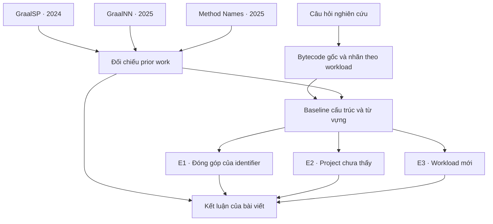

# DAG bài báo và thí nghiệm

Mỗi nút ở hàng đầu là một công trình đã đọc. Mũi tên đi từ tài liệu hoặc bước nghiên cứu đến bước sử dụng nó. Ví dụ, GraalSP giúp nhóm chọn baseline dùng đặc trưng cấu trúc, còn bài *Method Names* là căn cứ để kiểm tra riêng đóng góp của tên phương thức. Các cạnh trong hình biểu diễn quan hệ sử dụng bằng chứng của dự án. [Dữ liệu nguồn của DAG](../dependency_graph.yaml)

| Bài trong DAG | Phần liên quan đến dự án | Ghi chú và nguồn gốc |
| --- | --- | --- |
| GraalSP (2024) | Dùng đặc trưng Graal IR và XGBoost để dự đoán xác suất nhánh. Đã kiểm tra trích đoạn bài và tài liệu của tác giả. | [Ghi chú GraalSP](reading_notes/graalsp.md) · [Bài gốc](https://doi.org/10.1016/j.jss.2024.112058) |
| GraalNN (2025) | Dùng CFG và ngữ cảnh gọi hàm để dự đoán xác suất cạnh trong Graal IR. Ghi chú nêu điều kiện để so sánh với cạnh bytecode. | [Ghi chú GraalNN](reading_notes/graalnn.md) · [Bài gốc](https://doi.org/10.1145/3696443.3708958) |
| Improving ML-Based Static Profiling Using Method Names (2025) | Đo tác động của embedding tên phương thức lên phân loại method hotness. Nguồn là bản tóm tắt hội nghị một trang. | [Ghi chú Method Names](reading_notes/method-names.md) · [Kỷ yếu, tr. 36](https://simpozijum.matf.bg.ac.rs/KNJIGA_APSTRAKATA_2025.pdf#page=36) |

Thư mục này lưu metadata, ghi chú đọc và liên kết tới bản của nhà xuất bản hoặc tác giả. Khi thêm bài, dùng cùng một `paper_id` trong BibTeX, bảng bằng chứng và DAG, rồi liên kết ghi chú với nút nghiên cứu sử dụng bài đó. [Bibliography](papers.bib) · [Bảng bằng chứng](evidence_matrix.csv) · [Đối chiếu novelty](novelty_map.md)
