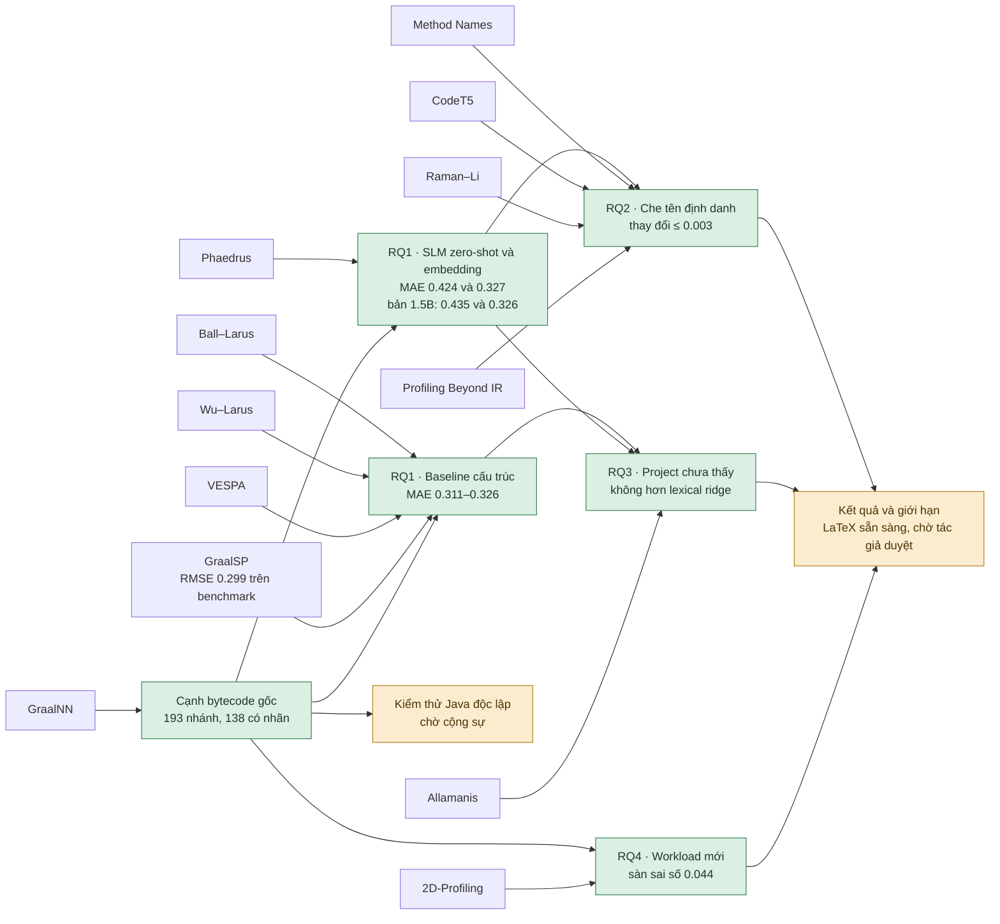

# DAG bài báo và thí nghiệm

Mũi tên chỉ từ nguồn đến quyết định sử dụng nguồn đó. Ví dụ, Raman–Li đã đưa tên hàm được gọi vào mô hình xác suất nhánh LLVM. Vì vậy, RQ2 cần so sánh SLM với mô hình từ vựng và đo tác động khi che tên trên cùng nhánh. Nút xanh đã có kết quả đo, nút vàng đang chờ người thực hiện. Trạng thái, tiêu chí nghiệm thu, con số chính và đường dẫn bằng chứng của từng nút nằm trong [DAG dạng YAML](../dependency_graph.yaml).

| Công trình | Quyết định liên quan | Nguồn |
| --- | --- | --- |
| [GraalSP (2024)](reading_notes/graalsp.md) | Dự đoán cạnh Graal IR bằng đặc trưng cấu trúc. Luận án của tác giả báo cáo RMSE 0.299 trên chương trình test tách riêng; bản thảo dùng con số này để so quy mô, không so cặp. | [Bài gốc](https://doi.org/10.1016/j.jss.2024.112058) · [Luận án, bảng 6.2](https://uvidok.rcub.bg.ac.rs/handle/123456789/6474) |
| [GraalNN (2025)](reading_notes/graalnn.md) | Liên kết chiều cạnh IR và đích nhảy bytecode. | [Bài gốc](https://doi.org/10.1145/3696443.3708958) |
| [Method Names (2025)](reading_notes/method-names.md) | Baseline từ vựng cho giả thuyết về tên. | [Bài gốc](https://research.matf.bg.ac.rs/handle/123456789/3037) |
| [Ball–Larus (1993)](reading_notes/ball-larus.md) | Phân biệt heuristic vòng lặp với dấu offset. | [Bài gốc](https://ftp.cs.wisc.edu/pub/techreports/1993/TR1137.pdf) |
| [Wu–Larus (1994)](reading_notes/wu-larus.md) | Phân biệt dự đoán chiều, xác suất và tần suất. | [Bài gốc](https://klasses.cs.uchicago.edu/archive/2017/fall/32001-1/papers/wu-larus-profiling.pdf) |
| [VESPA (2021)](reading_notes/vespa.md) | Chọn đối chứng hồi quy cấu trúc trên mã đã biên dịch. | [Bài gốc](https://homepages.dcc.ufmg.br/~fernando/publications/papers/AngelicaOOPSLA21.pdf) |
| [Raman–Li (2022)](reading_notes/raman-li.md) | Tiền lệ dùng tên hàm được gọi để ước lượng xác suất cạnh. | [Bài gốc](https://arxiv.org/html/2202.06728) |
| [CodeT5 (2021)](reading_notes/codet5.md) | Kiểm tra bằng cặp biểu diễn giữ và che tên. | [Bài gốc](https://aclanthology.org/2021.emnlp-main.685.pdf) |
| [Allamanis (2019)](reading_notes/duplicates.md) | Kiểm tra code trùng qua biên project. | [Bài gốc](https://miltos.allamanis.com/publications/2019adverse/) |
| [2D-Profiling (2006)](reading_notes/kim-input.md) | Đánh giá độ nhạy của cùng nhánh khi input thay đổi. | [Bài gốc](https://users.ece.cmu.edu/~omutlu/pub/kim_cgo06.pdf) |
| [Phaedrus (2026)](reading_notes/phaedrus.md) | Tiền lệ dùng LLM để tổng hợp thông tin profile cho hàm. | [Bài gốc](https://arxiv.org/abs/2412.06994) |

Nút *Profiling Beyond IR* là bản thảo mà nhóm PLATO mô tả đang thực hiện. Ngày kiểm tra và mức độ xác minh có trong [nhật ký tìm tài liệu](search_log.md).

Codex phụ trách nghiên cứu, chạy thí nghiệm và viết bản thảo. Cộng sự phụ trách kiểm thử Java độc lập. Các con số của nghiên cứu phải truy được về artifact của lần chạy. [Protocol](../../experiments/study/protocol.md) · [BibTeX](papers.bib) · [Bảng bằng chứng](evidence_matrix.csv) · [Đối chiếu novelty](novelty_map.md)
